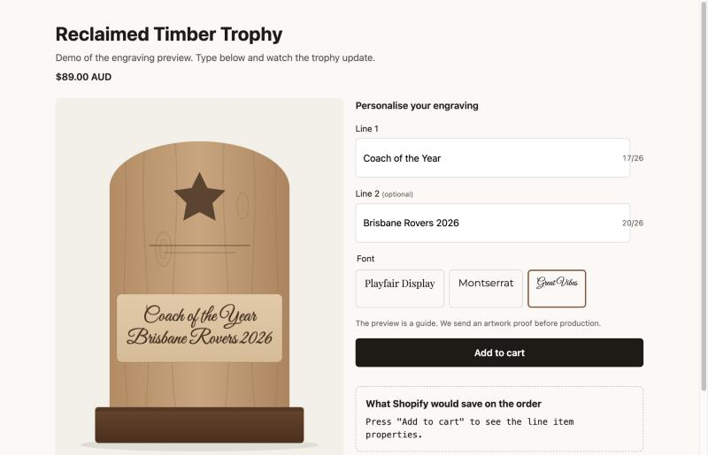

# Shopify Engraving Preview

A live engraving preview for Shopify product pages. Customers type up to two lines, pick a font and see the text on the product photo as they type. The text and font are saved on the order as line item properties, so they show up in the cart, at checkout and in the Shopify admin.

Built for personalised products like trophies, plaques, cutting boards and gifts.



**Try the live demo:** https://madihafqasim.github.io/shopify-engraving-preview/demo/

## Features

- Live preview over the product image, updated on every keystroke
- Text shrinks to fit the engraving area, so long names never spill over
- Font choice from any Google Fonts, with the preview waiting for the font to load before measuring
- Saves `Line 1`, `Line 2` and `Font` to the order with no app and no extra API calls
- Per-product settings through metafields: engraving position, character limit, fonts and whether line 1 is required
- Works on phones, keyboard friendly, and announces the preview to screen readers
- No dependencies: one Liquid snippet, about 130 lines of JavaScript and one stylesheet

## Files

| File | What it does |
|---|---|
| `snippets/engraving-preview.liquid` | Fields, preview markup and settings |
| `assets/engraving-preview.js` | Live update and text fitting |
| `assets/engraving-preview.css` | Layout and the engraved look |
| `demo/` | Standalone demo that runs without Shopify |

## Install (Horizon, Dawn and other Online Store 2.0 themes)

1. **Add the files.** In Shopify admin go to Online Store, Themes, then Edit code on your theme.
   - Under Snippets, add `engraving-preview.liquid` and paste in the snippet.
   - Under Assets, add `engraving-preview.js` and `engraving-preview.css` and paste in each file.
2. **Place it on the product page.** Open Customize, switch to the product template, and in the Product information section add a **Custom Liquid** block above the Buy buttons. Paste:

   ```liquid
   
   ```

3. **Optional: set it per product.** In Settings, Custom data, Products, add any of these metafield definitions, then fill them in on each product:

   | Metafield | Type | Default | Use |
   |---|---|---|---|
   | `engraving.area` | Single line text | `22,56,56,16` | Engraving position as `left,top,width,height` in % of the photo |
   | `engraving.max_chars` | Integer | `26` | Characters per line |
   | `engraving.fonts` | Single line text | `Playfair Display,Montserrat,Great Vibes` | Google Fonts to offer |
   | `engraving.required` | True or false | `false` | Make line 1 required before adding to cart |

To find the right `engraving.area` for a photo, open the photo in any image editor and read off where the engraving panel starts and ends as a percentage of the width and height.

## How it works

- The inputs sit outside the product form but use the `form` attribute, so the theme's own add to cart sends them as `properties[...]`. Themes name that form differently (`product-form-…` in Dawn, `BuyButtons-ProductForm-…` in Horizon), so if the expected ID isn't on the page, the script links the fields to the add to cart form in the same section.
- The preview area is positioned over the photo with percentages, so it stays in place at every screen size.
- To fit the text, the script sets the font size from the area's height and number of lines, measures the widest line, and scales down if it's too wide. A `ResizeObserver` refits it when the layout changes.
- `mix-blend-mode: multiply` and a light text shadow make the text look burned into the material rather than printed on top.

## Limits

- The preview uses the selected variant's main photo when the page loads. It doesn't follow the customer through other gallery images.
- It's a guide for the customer, not a print-ready proof. Production artwork should still be approved separately.
- If a page has more than one add to cart form in the same section, pass the right one: ``.

## Licence

MIT. See [LICENSE](LICENSE).

Built by Madiha F., web designer and SEO consultant.
